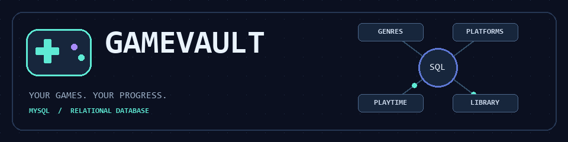

# GameVault

A MySQL database project for organizing video games and tracking personal game libraries. GameVault connects games with genres, platforms, developers, and publishers, and records each user's play status and hours played.

## Features

- A relational schema with primary keys, foreign keys, and junction tables for many-to-many relationships.
- A seeded catalog of 30 games, plus sample users and game metadata.
- Personal libraries with game status and playtime.
- Queries for highly rated games, above-average ratings, completed games, and user game history.
- Views for game history, completed games, highly rated games, and game genres.
- Examples of inserting records, updating playtime, and modifying table structure.

## Repository files

| File | Purpose |
| --- | --- |
| [GameVault.sql](GameVault.sql) | Creates and seeds the database, demonstrates a user-library workflow, and creates reporting views. |
| [gamevault_queries.sql](gamevault_queries.sql) | Additional queries and examples of updates and schema changes. |

## Database structure

| Table | Stores |
| --- | --- |
| `vault_user` | User IDs and unique usernames. |
| `game` | Game titles, ratings, and release dates. |
| `genre` | Genre names. |
| `platform` | Gaming platforms. |
| `developers` | Developer names. |
| `publishers` | Publisher names. |
| `user_game` | Each user's games, status, and hours played. |
| `game_genre` | Game-to-genre relationships. |
| `game_platform` | Game-to-platform relationships. |
| `game_developers` | Game-to-developer relationships. |
| `game_publishers` | Game-to-publisher relationships. |

Each junction table uses a composite primary key to prevent duplicate relationships and foreign keys to link its parent records.

## Getting started

You need a running MySQL server and a SQL client, such as the `mysql` command-line client or MySQL Workbench. Your database account needs permission to create and drop the `gamevault` database, create tables and views, and insert and update records.

> **Database reset:** `GameVault.sql` starts with `DROP DATABASE IF EXISTS gamevault`. Running it deletes any existing `gamevault` database and replaces it with the sample data. Use a development database where that reset is acceptable.

1. Clone the repository:

   ```sh
   git clone https://github.com/mcampo0215/GameVault.git
   cd GameVault
   ```

2. Start the MySQL client, replacing `YOUR_USERNAME` with your database username:

   ```sh
   mysql --default-character-set=utf8mb4 -u YOUR_USERNAME -p
   ```

3. Run the setup script from the MySQL prompt:

   ```sql
   SOURCE GameVault.sql;
   ```

   In MySQL Workbench, open `GameVault.sql` and execute it against your development server instead. The script selects `gamevault`, loads sample records, runs a demonstration workflow, and creates four views.

4. Explore the database:

   ```sql
   USE gamevault;
   SHOW TABLES;
   SELECT * FROM popular_games;
   SELECT * FROM view_completed_games;
   ```

## Example queries

Find games with ratings above the catalog average:

```sql
SELECT title, rating
FROM game
WHERE rating > (SELECT AVG(rating) FROM game)
ORDER BY rating DESC;
```

Inspect a user's library, including status and playtime:

```sql
SELECT u.username, g.title, ug.game_status, ug.hours_played
FROM vault_user AS u
JOIN user_game AS ug ON u.user_id = ug.user_id
JOIN game AS g ON ug.game_id = g.game_id
WHERE u.user_id = 1;
```

The setup script also creates these views:

| View | Result |
| --- | --- |
| `view_user_game_history` | Users and the games in their libraries. |
| `view_completed_games` | Library entries whose status is `Complete`. |
| `popular_games` | Games rated above 4.5, ordered by rating descending. |
| `view_game_and_genres` | Games with their genres combined using `GROUP_CONCAT`. |

## Additional SQL exercises

After loading the database, open `gamevault_queries.sql` and run the statements you want to explore. To execute the entire file from the MySQL prompt:

```sql
USE gamevault;
SOURCE gamevault_queries.sql;
```

This file also changes data: it temporarily adds a `price` column, assigns a price, drops that column, and marks one user's game as complete. The setup script likewise inserts a demonstration user and updates their library. Review these examples before running them against data you want to keep.

Game status is stored as free-form text; the sample scripts use values such as `Complete`, `Incomplete`, `Backlog`, `In progress`, and `In Progress`.
